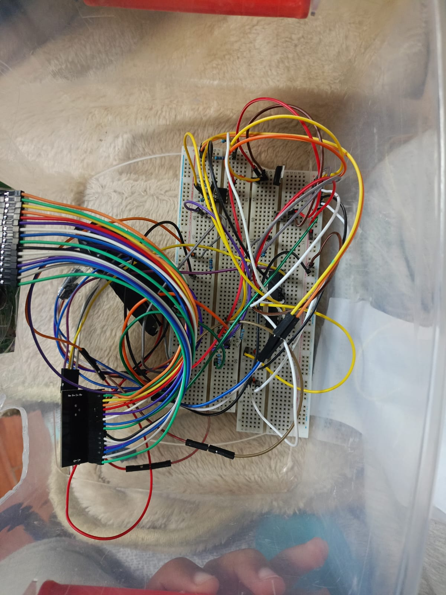
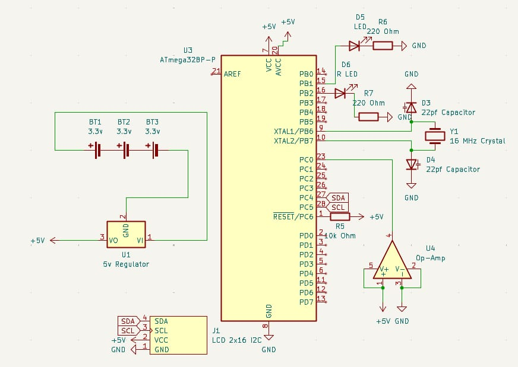
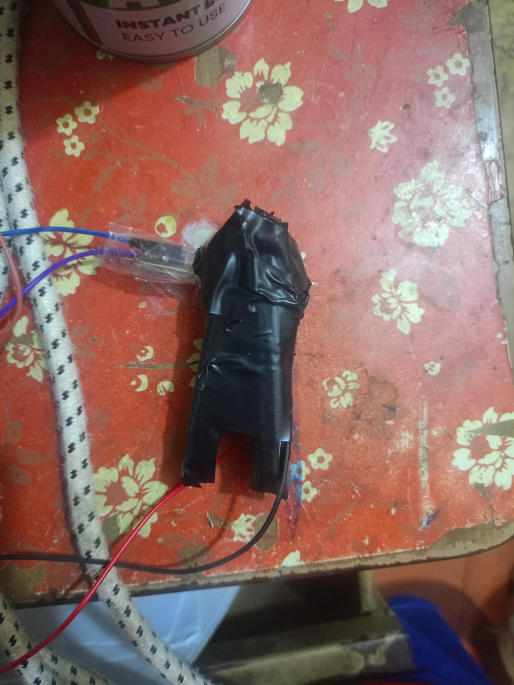

# Pulse oximeter prototype

I built this to learn how a pulse oximeter works without starting with a ready-made sensor module. The optical sensor uses separate red and infrared LEDs and a phototransistor, mounted in a clothes clip with black wrapping to block outside light.

## How the build went

I designed a standalone ATmega328P circuit in KiCad, including its power, reset, and clock connections. For the first breadboard tests I used an Arduino Uno to get things working faster, then moved the connections over to the standalone chip after burning its bootloader.

The build followed the general approach of an Instructables project, with changes to the controller and display. I used a standard LCD instead of a TFT, and made the sensor housing from a clothes clip rather than printing one.

The build journal covers six days and about 19 hours of work, after the initial research and design. During testing I detected pulse signals. The repo doesn't include a calibration study or accuracy results for oxygen saturation, so this is a learning prototype.

## Circuit and sensor

## Files

- [KiCad schematic](Sch.kicad_sch)
- [Build journal](JOURNAL.MD)
- [Test video](test%20vid.mp4)

The photos and journal document the electronics, sensor assembly, and move from the Uno to the ATmega328P. Firmware hasn't been added to this repo yet.
